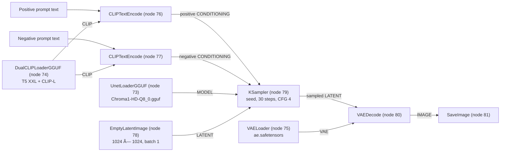

# ComfyUI Visual AI Asset Pipeline

A node-based AI execution backend for generating visual assets and delivering them to modern web applications. ComfyUI provides the workflow runtime; API-format workflow exports make those visual pipelines callable from application backends, batch jobs, and content-production systems.

## Project Overview

This repository combines ComfyUI's visual workflow engine with an integration pattern for programmatic asset generation:

- **Visual pipeline authoring:** Compose model loading, prompt conditioning, sampling, decoding, and output nodes into reusable graphs.
- **Workflow templates:** The [`blueprints/`](blueprints/) directory contains visual workflow templates for image, video, audio, and other tasks.
- **Headless execution:** Submit an API-format workflow graph to ComfyUI's REST API without driving the browser interface.
- **Application integration:** A frontend can submit generation requests to its application backend, which can populate workflow inputs, enqueue work, and return generated assets to the client.

The model and custom-node requirements depend on the selected workflow. This repository provides the ComfyUI runtime and templates; install the required model files and any custom nodes before executing a workflow.

## Pipeline Architecture & Workflow Topology

The diagram below maps the local Chroma text-to-image graph at `user/default/workflows/Chroma-txt2img-Base.json`. That user-local workflow file is not tracked in this repository; the diagram reflects its actual connections and data types. This workflow does not include ControlNet, IP-Adapter, LoRA, or additional image post-processing.



- **Separate conditioning paths:** The shared dual text encoder feeds positive and negative prompt encoders independently, so each conditioning input can be tuned without changing model loading or sampling.
- **Explicit sampler inputs:** The sampler receives its model, both conditioning values, latent input, and sampling controls at distinct sockets. The seed and generation settings can therefore be exposed as API-driven controls.
- **Independent model and VAE loading:** The GGUF diffusion model and VAE are loaded as separate components, making their roles and dependencies clear in the graph.
- **Direct decode and save:** The sampled latent is decoded once and sent directly to image output. This keeps the baseline path simple to inspect and avoids implying unconfigured conditioning adapters or post-processing.

## Headless API Integration

### Export a workflow

Build or open a workflow in ComfyUI, then select **File > Export (API)**. This exports the executable node graph used by the API, rather than the regular UI workflow layout. Save the export in a location your backend can load, such as `workflows/text_to_image_api.json`. The `workflows/` directory is a suggested location for your API exports; the visual templates themselves are in `blueprints/`.

API exports use node IDs as JSON keys. Before integrating a workflow, identify the positive text-encoder node and the `KSampler` node in the export. Their IDs and input names are workflow-specific.

### Submit, monitor, and retrieve an image

The example below demonstrates the server-side flow: inject a request's prompt and seed into an exported graph, submit it to `POST /prompt`, poll `GET /history/{prompt_id}`, and retrieve the generated image through `GET /view`.

```python
import json
import random
import time
from pathlib import Path
from urllib.parse import urlencode
from urllib.request import Request, urlopen

COMFY = "http://127.0.0.1:8188"
POSITIVE_PROMPT_NODE = "6"  # Replace with the positive text-encoder node ID.
KSAMPLER_NODE = "3"         # Replace with the KSampler node ID.

# These values can come from a validated frontend request.
user_prompt = "A cinematic mountain landscape at sunrise"
seed = random.SystemRandom().randrange(0, 2**64)

workflow = json.loads(
    Path("workflows/text_to_image_api.json").read_text(encoding="utf-8")
)
workflow[POSITIVE_PROMPT_NODE]["inputs"]["text"] = user_prompt
workflow[KSAMPLER_NODE]["inputs"]["seed"] = seed

request = Request(
    f"{COMFY}/prompt",
    data=json.dumps({"prompt": workflow}).encode("utf-8"),
    headers={"Content-Type": "application/json"},
)
with urlopen(request, timeout=30) as response:
    prompt_id = json.load(response)["prompt_id"]

deadline = time.monotonic() + 600
while time.monotonic() < deadline:
    with urlopen(f"{COMFY}/history/{prompt_id}", timeout=30) as response:
        history = json.load(response)

    result = history.get(prompt_id)
    if result:
        status = result.get("status", {}).get("status_str")
        if status == "error":
            raise RuntimeError(f"ComfyUI execution failed: {result['status']}")
        if status == "success":
            image = next(
                (
                    image
                    for output in result.get("outputs", {}).values()
                    for image in output.get("images", [])
                ),
                None,
            )
            if image is None:
                raise RuntimeError("Workflow completed without an image output")

            query = urlencode(
                {
                    "filename": image["filename"],
                    "subfolder": image["subfolder"],
                    "type": image["type"],
                }
            )
            with urlopen(f"{COMFY}/view?{query}", timeout=60) as response:
                Path("generated.png").write_bytes(response.read())
            print(f"Saved generated.png (seed={seed})")
            break

    time.sleep(1)
else:
    raise TimeoutError(f"Prompt {prompt_id} did not finish within 10 minutes")
```

For event-driven progress rather than polling, connect to ComfyUI's `/ws` endpoint and correlate execution events with the returned prompt ID. The repository's [`script_examples/`](script_examples/) directory includes REST and WebSocket API examples.

### Production integration pattern

Keep the browser-facing API separate from the model worker:

1. The frontend sends prompt parameters to an application backend.
2. The backend validates inputs, selects an approved workflow, and maps request values to its API graph.
3. A worker submits the graph to ComfyUI and tracks the prompt ID until completion.
4. The application returns an asset URL or result metadata to the frontend.

For production deployments, put authentication, rate limiting, request validation, queue management, retries, and asset retention in the application or worker layer. Keep ComfyUI on a private network rather than exposing its execution API directly to untrusted clients. Multiple workers can be managed by the deployment platform; GPU capacity and model residency determine practical concurrency.

## Hardware Performance & Optimization

The target GPU for this pipeline is an NVIDIA GeForce RTX 3090 with 24 GB of VRAM. The local Chroma workflow is configured for 1024 × 1024 output, batch size 1, and 30 sampling steps. Its diffusion model file is `Chroma1-HD-Q8_0.gguf` (about 9.1 GiB on disk); Q8_0 describes quantized model weights, not the compute precision of all activations or intermediate tensors.

### Benchmark status

The table records the checked-in workflow configuration and candidate comparison points. Peak VRAM and generation time are marked **Not measured** rather than estimated: results depend on the exact GPU runtime, ComfyUI/PyTorch versions, model and text-encoder files, sampler, and whether other applications are using the GPU. The working environment used to inspect this repository has CPU-only PyTorch, so it cannot produce valid RTX 3090 timings.

| Resolution | Steps | Precision / weight format | Peak VRAM | Generation speed |
|---|---:|---|---|---|
| 1024 × 1024, batch 1 (checked-in Chroma graph) | 30 | Chroma Q8_0 weights; runtime compute dtype not recorded | Not measured | Not measured |
| 1024 × 1024, batch 1 (FP16 comparison run) | 30 | FP16 runtime, if supported by the selected model path | Not measured | Not measured |
| 1024 × 1024, batch 1 (FP8 comparison run) | 30 | FP8 weights/runtime only where model and backend support it | Not measured | Not measured |
| 1024 × 1024, batch 2 (capacity test) | 30 | Record actual runtime dtype and weight format | Not measured | Not measured |

The RTX 3090's 24 GB capacity provides more room for model weights, activations, and larger batches than smaller-memory cards, and may allow SDXL, Flux, or Chroma workflows to run with fewer offloads. This is not guaranteed for every model, resolution, encoder combination, or batch size: the Chroma GGUF file alone is about 9.1 GiB, and inference requires additional VRAM for text encoders, activations, the VAE, and temporary buffers. Increase batch size only after measuring peak allocation and leaving headroom for the display and other GPU processes.

### Tuning and measurement

- Start with ComfyUI's default dynamic VRAM management. Try `python main.py --highvram` only when the full workflow fits comfortably in available GPU memory; this keeps models resident and can avoid reload/offload costs between runs.
- The graph has no ControlNet, IP-Adapter, or LoRA branches, avoiding their additional model and activation memory. Add such modules only when the workflow requires them, then remeasure.
- The RTX 3090 is an Ampere GPU and does not provide native FP8 Tensor Core execution. Prefer a supported FP16 path for a reduced-precision comparison; do not assume an FP8 weight format will accelerate inference on this card.
- Record resolution, batch size, steps, sampler, model/encoder formats, runtime precision, ComfyUI and PyTorch versions, and whether the timing includes model loading. Warm up the model, measure several runs with `nvidia-smi` monitoring GPU memory, and report both peak VRAM and end-to-end seconds per image.

## Quickstart & Reproducibility

The steps below target the Windows development environment used for this Chroma pipeline: Python 3.12 and an NVIDIA GPU. They install this project fork, its Python requirements, ComfyUI-Manager, and the GGUF custom node used by the local Chroma workflow.

### 1. Clone the project and create an isolated environment

```powershell
git clone --branch master https://github.com/TheTravisM/ComfyUI-Workflow-Automation.git
cd ComfyUI-Workflow-Automation
py -3.12 -m venv .venv
.\.venv\Scripts\Activate.ps1
python -m pip install --upgrade pip
```

### 2. Install CUDA-enabled PyTorch and project dependencies

Install the CUDA 13.0 PyTorch wheels first so the unpinned `torch` entry in `requirements.txt` is already satisfied by the GPU build:

```powershell
python -m pip install --index-url https://download.pytorch.org/whl/cu130 torch torchvision torchaudio
python -m pip install -r requirements.txt
python -m pip install -r manager_requirements.txt
```

Check that PyTorch can use the GPU before continuing:

```powershell
python -c "import torch; print(torch.__version__); print(torch.cuda.is_available()); print(torch.cuda.get_device_name(0) if torch.cuda.is_available() else 'CUDA unavailable')"
```

### 3. Install and sync required custom nodes with ComfyUI-Manager

Start ComfyUI with Manager enabled for initial setup:

```powershell
python main.py --enable-manager --port 8188
```

Open `http://127.0.0.1:8188`, use **Manager → Custom Nodes Manager** to search for and install **ComfyUI-GGUF**, then restart ComfyUI. For subsequent environment syncs, use Manager's node update and snapshot features so the installed node set can be restored consistently.

For a fixed GGUF node revision matching the local environment, pin the installed checkout after installation:

```powershell
git -C custom_nodes\ComfyUI-GGUF checkout 6ea2651e7df66d7585f6ffee804b20e92fb38b8a
python -m pip install -r custom_nodes\ComfyUI-GGUF\requirements.txt
```

The repository's `requirements.txt` and `manager_requirements.txt` do not lock every transitive Python package version. For byte-for-byte environment replication, capture and retain a tested `pip freeze` output and a ComfyUI-Manager snapshot alongside the deployment configuration.

### 4. Provide model assets and workflow

The model files and the workflow under `user/default/workflows/` are local assets and are not included in this repository. Supply them through your approved artifact storage, then place the Chroma assets in the locations expected by the graph:

- `Chroma1-HD-Q8_0.gguf` in `models\unet`
- `t5xxl_fp16.safetensors` and `clip_l.safetensors` in `models\clip`
- `ae.safetensors` in `models\vae`
- `Chroma-txt2img-Base.json` in `user\default\workflows`

### 5. Launch the API server

From the activated virtual environment and repository root:

```powershell
python main.py --listen --port 8188
```

The server accepts API requests on port `8188`. `--listen` binds beyond localhost so remote frontend/backend clients can connect; only expose it on a trusted network and apply appropriate firewall controls. Do not make the unauthenticated ComfyUI API directly accessible to untrusted clients.
